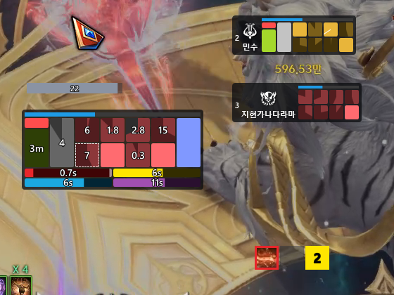
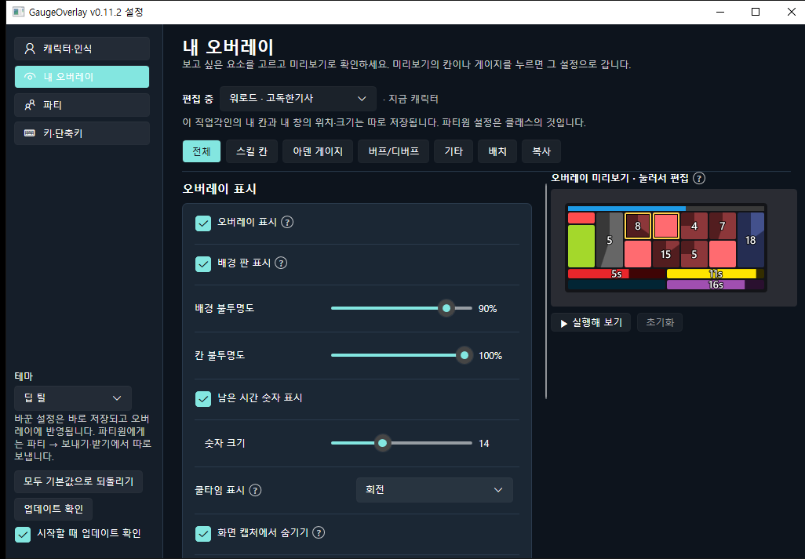
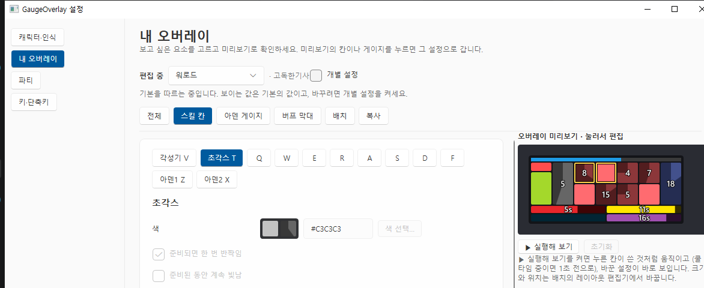
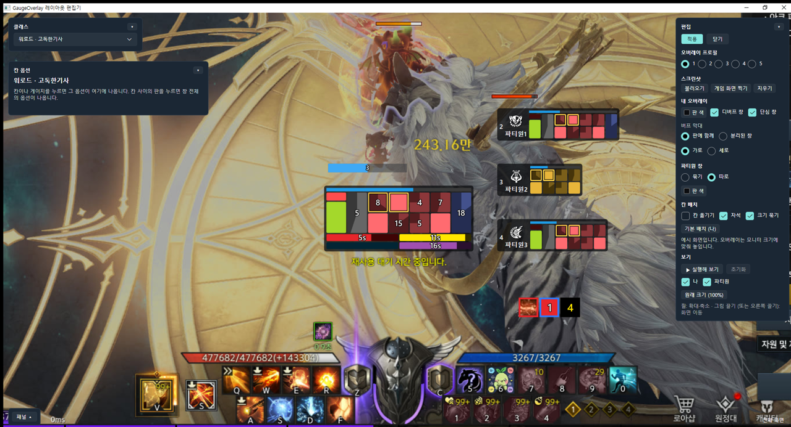
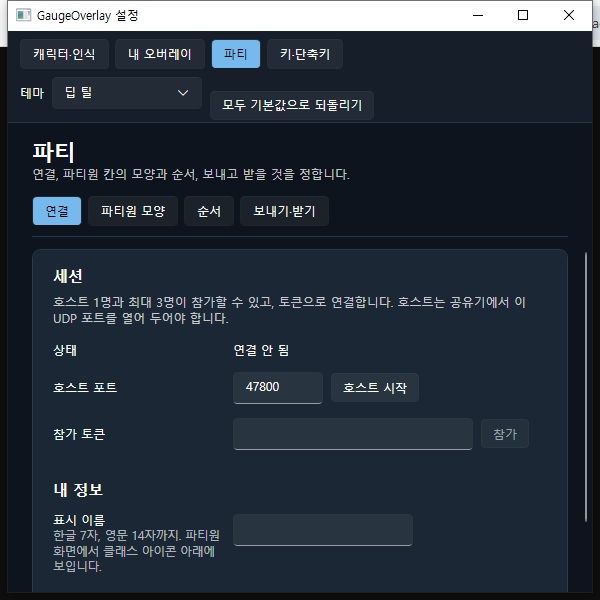

# GaugeOverlay

로스트아크(KR)의 스킬창을 화면에서 읽어, 스킬 쿨타임과 아덴 게이지를 한눈에 보이는 오버레이로 보여 주는 Windows 앱입니다. 파티원끼리 연결하면 서로의 쿨타임도 볼 수 있습니다.

- 화면 캡처와 키 입력만 읽습니다. 게임 파일이나 메모리는 건드리지 않습니다.
- 쿨타임만 감지합니다. 침묵, 마나 부족처럼 스킬을 쓸 수 없는 상태는 표시하지 않습니다.
- 사용에 따른 책임은 사용자에게 있습니다.
- 지금은 **베타**(0.x)입니다. 기능과 설정이 바뀔 수 있습니다.

*내 오버레이: 위쪽 막대는 아덴 게이지, 그 아래 각성기·초각스·일반스킬 8칸·아덴스킬, 맨 아래는 버프 막대입니다.*

## 기능

- **스킬 쿨타임:** 각성기, 초각스, 일반스킬 8칸, 아덴스킬 칸의 남은 시간을 게임 화면의 숫자에서 읽어, 칸이 시계 방향으로 차오르는 모습과 남은 초로 보여 줍니다. 준비되면 한 번 반짝이고, 원하면 준비된 동안 계속 빛나게 할 수 있습니다.
- **초각기 표시:** 각성기 게이지가 차서 게임에 뜨는 변화 표시를 따로 보여 줍니다.
- **아덴 게이지:** 지원하는 직업각인은 게이지를 오버레이 위쪽 막대로 보여 줍니다. 구간 구분선, 구간별 색, 빛나는 조건을 직업각인마다 정할 수 있습니다.
- **직업각인 감지:** 스킬창 다시 맞추기(Ctrl+Shift+D)를 누르면 클래스와 직업각인을 스킬창에서 알아봅니다. 로딩이나 컷신 뒤에 저절로 바꾸지 않습니다. 설정한 클래스와 화면이 다르면 게이지가 빨갛게 깜빡이고 알려 주며, 10초 안에 고치지 않으면 기본으로 돌아갑니다.
- **버프 막대:** 공증, 아덴 피증, 초각스 피증, 뎀증의 남은 시간을 막대로 보여 줍니다. 파티원에게는 보내지 않습니다.
- **디버프 (레이드, 베타):** 설정에서 레이드를 고르면(지금은 G3 모르둠) 따로 된 디버프 창에 내 색(빨강/파랑), 교체 때 데려갈 인원(보스 아래 빨강·파랑 숫자가 반반이 되도록 자동 계산), 번개 디버프(깜빡이며 남은 초)를 보여 줍니다. 번개 칸에는 결투자 디버프도 보입니다(4에서 0까지 카운트다운 뒤 아이콘, 처음 보인 뒤 30초 동안 유지, 컷신이 끝나고 다시 보여도 카운트다운은 한 번만). 보스 숫자는 7을 뺀 0–8을 읽습니다(7은 다른 색 숫자로 계산).
- **파티 공유:** 호스트 1명과 최대 3명이 토큰으로 연결해 서로의 쿨타임, 초각기 표시, 아덴 게이지를 봅니다. 연결은 암호화됩니다. 파티원 칸의 색·크기·배치는 내 설정으로 칠하거나 파티원이 보낸 것을 받아 쓸 수 있습니다.
- **클래스별 설정:** 내 칸은 직업각인마다, 파티원 칸은 클래스마다 표시할 것, 칸 배치, 색을 따로 둘 수 있습니다. 설정의 **편집 중**에서 다른 직업각인을 고르면 그 직업각인을 직접 고칠 수 있습니다.
- **레이아웃 편집기:** 게임 화면 스크린샷 위에 내 오버레이, 버프 창, 파티원 창을 그대로 그려 놓고 위치와 크기를 맞춥니다. 칸 하나하나를 옮기거나 크기를 바꿀 수도 있습니다. 다른 칸과 떨어뜨려 둔 칸은 자기 판 위에 따로 그려집니다.
- **오버레이 프로필 5개:** 창 위치·크기와 판 색을 프로필마다 저장하고 트레이나 단축키로 바꿉니다.
- **화면 캡처에서 숨기기:** OBS, 디스코드 화면 공유에 오버레이가 찍히지 않게 할 수 있습니다.
- **해상도:** 1920×1080, 2560×1440, 3840×2160(4K), 21:9 모니터, 게임의 강제 21:9를 지원합니다. HUD 크기 80/90/100/105/110%는 스킬창 맞추기가 스스로 찾습니다. 버프 크기(80–120%, 기본 120%)는 찾지 못하므로 설정 → 스킬창 맞추기에서 게임과 같게 골라 주세요.

## 지원 클래스

모든 클래스에서 쿨타임(각성기, 초각스, 일반스킬 8칸), 버프 막대, 파티 공유가 동작합니다. 아래 표의 직업각인은 여기에 더해 아덴 게이지, 아덴스킬 칸, 직업각인 자동 감지까지 모두 지원합니다.

| 클래스 | 직업각인 | 아덴 게이지 | 아덴스킬 칸 |
|---|---|---|---|
| 워로드 | 고독한기사 | 기본 막대 | 아덴2 |
| 워로드 | 전투태세 | 50% 구분선, 아덴스킬을 쓸 수 있으면 빛남 | 아덴2 (게이지가 모자라면 어둡게) |
| 발키리 | 빛의기사 | 다 차고 C가 준비되면 빛남 | Z, C (게이지가 모자라면 어둡게) |
| 발키리 | 해방자 | 80% 이상이고 Z가 준비되면 빛남 | Z, C (게이지가 모자라면 어둡게) |
| 바드 | 절실한구원 | 4구간, 다 찬 구간마다 빛남 | 아덴1, 아덴2 |
| 바드 | 진실된용맹 | 3구간, 다 찬 구간마다 빛남 | 아덴1, 아덴2 |
| 도화가 | 만개 | 3구간, 다 찬 구간마다 빛남 | 아덴1, 아덴2 |
| 도화가 | 회귀 | 3구간, 다 찬 구간마다 빛남 | 아덴1, 아덴2 |

나머지 클래스는 아덴 게이지와 아덴스킬 칸 없이 표시됩니다. 파티원 창에는 30개 클래스 모두 클래스 아이콘이 나옵니다.

앱 안에서는 설정 → 캐릭터·인식 → 캐릭터 아래 **지원하는 직업각인** 표에서 직업각인마다 직업각인 감지, 아덴 게이지(어떻게 읽고 어떻게 보여 주는지), 아덴 스킬을 볼 수 있습니다. 업데이트로 새로 추가된 직업각인이나 기능에는 그 화면을 한 번 볼 때까지 **NEW**가 붙습니다.

### 클래스별 지원 단계

클래스는 세 단계로 나누어 추가합니다. ✓ = 지원, – = 아직 없음.

| 직업군 | 클래스 | 1. 직업각인 감지 | 2. 아덴 게이지 | 3. 아덴 스킬 |
|---|---|:-:|:-:|:-:|
| 워리어 | 워로드 | ✓ | ✓ | ✓ |
| 워리어 | 홀리나이트 | ✓ | – | – |
| 워리어 | 버서커 | ✓ | – | – |
| 워리어 | 디스트로이어 | – | – | – |
| 워리어 | 가디언나이트 | – | – | – |
| 워리어 | 발키리 | ✓ | ✓ | ✓ |
| 워리어 | 슬레이어 | ✓ | – | – |
| 무도가 | 배틀마스터 | – | – | – |
| 무도가 | 인파이터 | – | – | – |
| 무도가 | 기공사 | – | – | – |
| 무도가 | 창술사 | – | – | – |
| 무도가 | 스트라이커 | – | – | – |
| 무도가 | 브레이커 | – | – | – |
| 헌터 | 데빌헌터 | – | – | – |
| 헌터 | 블래스터 | – | – | – |
| 헌터 | 호크아이 | – | – | – |
| 헌터 | 스카우터 | – | – | – |
| 헌터 | 건슬링어 | – | – | – |
| 마법사 | 바드 | ✓ | ✓ | ✓ |
| 마법사 | 서머너 | – | – | – |
| 마법사 | 아르카나 | – | – | – |
| 마법사 | 소서리스 | – | – | – |
| 암살자 | 블레이드 | – | – | – |
| 암살자 | 데모닉 | – | – | – |
| 암살자 | 리퍼 | – | – | – |
| 암살자 | 소울이터 | – | – | – |
| 스페셜리스트 | 도화가 | ✓ | ✓ | ✓ |
| 스페셜리스트 | 기상술사 | – | – | – |
| 스페셜리스트 | 환수사 | – | – | – |
| 스페셜리스트 | 차원술사 | ✓ | – | – |

지원되지 않는 클래스를 플레이하신다면 [클래스 추가 요청 안내](docs/class-request.md)를 보고 자료를 보내 주세요. 준비된 단계부터 하나씩 추가합니다.

## 필요한 것

- Windows 10 2004 이상 또는 Windows 11 (64비트).
- 로스트아크 한국 서버 클라이언트.
- 파티 호스트를 하려면 공유기에서 UDP 47800 포트(바꿀 수 있음)를 열어 두어야 합니다. 참가만 할 때는 필요 없습니다.

## 설치

1. 이 저장소의 **Releases**에서 `GaugeOverlay-v0.9.1.zip`을 받습니다.
2. 원하는 폴더에 압축을 풉니다. `GaugeOverlay.exe`와 `Profiles` 폴더가 같은 곳에 있어야 합니다.
3. `GaugeOverlay.exe`를 실행합니다. 설치 과정은 없고 .NET도 따로 설치할 필요가 없습니다.

처음 실행할 때 "Windows의 PC 보호" 창이 뜨면 **추가 정보 → 실행**을 누르세요. 코드 서명이 없는 프로그램이라 Windows가 한 번 확인하는 것이며, 새 버전을 받을 때마다 다시 뜰 수 있습니다.

설정은 `%APPDATA%\GaugeOverlay\settings.json`에 저장됩니다. 이 파일을 복사하면 다른 PC에서도 같은 설정을 쓸 수 있습니다.

### 업데이트

지금 버전은 설정 창 제목에 나옵니다. 앱이 시작할 때 새 버전이 있는지 확인합니다. 설정 왼쪽 아래 **모두 기본값으로 되돌리기** 밑의 **업데이트 확인**을 누르면 언제든 직접 확인할 수 있습니다. 새 버전이 있으면 한 번 알리고, 설정 창 제목에 "(업데이트 있음)"이 붙으며, 버튼이 **vX 받기**로 바뀝니다. 그 버튼을 누르면 받아서 설치하고 새 버전으로 다시 시작합니다. 누르기 전에는 아무것도 받지 않습니다. 설정, 배운 값, 저장된 아이콘은 그대로 남고, 다시 시작하면 바뀐 내용을 한 번 보여 줍니다. 확인을 끄려면 설정 왼쪽 아래의 **시작할 때 업데이트 확인**을 끕니다. 알파 버전(1.x)은 베타로 자동 업데이트되지 않으니, v0.9.0을 한 번 직접 받아 주세요.

## 처음 실행

처음 실행하면 세 단계 안내 창이 열립니다.

1. **키 설정:** 게임 기본 키가 채워져 있습니다. 게임에서 바꾼 키만 고칩니다.
2. **캐릭터:** 직업군 → 클래스 → 직업각인을 고릅니다.
3. **스킬창 맞추기:** 스킬을 쓸 수 있는 곳에서 모든 스킬이 쿨 돈 상태로 둔 뒤(수련장에서는 쿨초) [맞추기]를 누릅니다. 앱이 스킬창의 위치와 크기, 직업각인을 알아냅니다. 게임의 버프 크기는 찾지 않으니 설정 → 캐릭터·인식 → 스킬창에서 게임과 같게 맞춰 주세요(기본 120%).

그 뒤로는 트레이 아이콘과 오버레이만 쓰면 됩니다. 앱은 창을 모두 닫아도 작업 표시줄 오른쪽 알림 영역에서 계속 실행됩니다. 아이콘이 보이지 않으면 시계 옆 ^ 안에 있으니, 시계 옆으로 끌어다 두면 항상 보입니다.

해상도나 HUD 크기를 바꾸면 트레이의 **스킬창 다시 맞추기**(Ctrl+Shift+D)를 스킬을 쓸 수 있는 곳에서 다시 하면 됩니다. 버프 크기를 바꿨으면 설정에서도 바꿔 주세요. 해상도별로 맞춘 값을 따로 저장하므로, 전에 맞춘 해상도로 돌아가면 다시 맞출 필요가 없습니다.

## 사용법

### 트레이 메뉴

트레이 아이콘을 오른쪽 클릭하면 메뉴가, 두 번 클릭하면 설정 창이 열립니다.

- **설정 열기**, 레이아웃 편집기
- 오버레이 표시, 편집 모드, 테스트 모드(맨 앞 창 따라가기, 열린 창 목록, 끄기; 아래 [테스트 모드](#테스트-모드)), 오버레이 프로필 1–5
- 캐릭터, 디버프(레이드), 파티(호스트 시작, 참가, 토큰 복사, 나가기)
- 스킬창 다시 맞추기, **인식 도구**: 직업각인 다시 감지, 스킬 등록, 아이콘 다시 읽기, 디버그 창
- 종료

### 단축키

| 동작 | 기본 키 |
|---|---|
| 오버레이 표시/숨기기 | Ctrl+Shift+H |
| 편집 모드 (오버레이를 끌어서 옮기고 크기 조절) | Ctrl+Shift+E |
| 스킬창 다시 맞추기 | Ctrl+Shift+D |
| 테스트 모드 | Ctrl+Shift+T |
| 오버레이 프로필 1–5 | 없음 (설정에서 지정) |

단축키는 설정 → 키·단축키 → 앱 단축키에서 바꿉니다. 다른 단축키나 스킬 키와 겹치면 빨간 테두리로 알려 줍니다.

### 설정 창

설정은 왼쪽의 네 영역으로 나뉩니다. 바꾼 값은 바로 저장되고 오버레이에 반영됩니다. 화면에는 이름만 나오고, 설명은 이름 옆 **?**에 마우스를 올리거나 Tab으로 가면 나옵니다.

- **캐릭터·인식:** 캐릭터(선택, 직업각인 다시 감지, 지원하는 직업각인), 스킬창(맞추기, 스킬창 위치, 수동 조정, 스킬 등록). 아덴 게이지의 배운 값은 내 오버레이 → 아덴 게이지에서 지웁니다.
- **내 오버레이:** 전체 표시, 스킬 칸, 아덴 게이지, 버프 막대, 배치, 복사. 오른쪽 미리보기에서 칸이나 게이지를 누르면 그 설정으로 바로 갑니다. **▶ 실행해 보기**를 켜면 미리보기의 칸이 실제처럼 움직입니다.
- **파티:** 연결, 파티원 모양, 순서, 보내기·받기.
- **키·단축키:** 게임 키, 앱 단축키.

맨 위의 **편집 중** 줄에서 고칠 직업각인을 고릅니다. 직업각인마다 설정이 따로 있습니다('기본'은 클래스 정보가 없을 때의 설정입니다). 지금 캐릭터가 아닌 직업각인을 고르면 미리보기와 칸 옵션이 그 직업각인을 따르고, 설정을 열어 둔 동안 화면의 내 오버레이도 그 직업각인의 예시로 바뀝니다(저장된 아이콘이 있으면 그 아이콘으로 보입니다). 설정을 닫으면 원래대로 돌아옵니다. 파티원 칸의 모양은 클래스마다 하나여서, 같은 클래스의 직업각인이 함께 씁니다.

스킬 칸에서는 위의 칩(각성기, 초각스, 스킬 키, 아덴)으로 칸을 고르고, 그 칸만 또는 같은 그룹 전체의 색과 효과를 바꿉니다.

**아이콘으로 표시**를 켜면 칸에 색 대신 게임 화면의 스킬 아이콘을 그립니다. 아이콘은 직업각인마다 저장되며, 저장된 아이콘이 없는 칸이 있을 때만 화면에서 읽습니다. 스킬을 바꿨으면 **아이콘 다시 읽기**(스킬 칸, 트레이, 단축키)를 누르면 모든 칸을 다시 읽습니다.

**쿨타임 중 숨기기**를 켠 칸은 쿨타임 동안 사라졌다가 준비되면 다시 나타납니다. 쿨타임을 확실히 읽지 못한 칸, 사용 횟수가 남은 스택 스킬, 사용 후 3초 유지 숫자는 그대로 보입니다. 레이아웃 편집기에서는 흐리게 보여 옮길 수 있습니다.

설정 창의 색은 왼쪽 아래 **테마**에서 고릅니다: 딥 틸(기본), Windows 설정 따름, 밝게, 어둡게.

초기화 버튼은 무엇을 되돌리는지 이름에 적혀 있고(예: "아덴 게이지 되돌리기"), 누르면 한 번 더 확인합니다. **모두 기본값으로 되돌리기**는 캐릭터, 오버레이 프로필(위치·크기), 창 위치, 배운 게이지 값, 테마를 남깁니다.

### 레이아웃 편집기

트레이나 설정 → 내 오버레이 → 배치에서 엽니다. 게임 화면 스크린샷 위에 오버레이, 버프 창, 파티원 창이 실제 위치에 그려집니다. 끌어서 옮기고, 칸이나 아덴 게이지를 누르면 왼쪽 **칸 옵션**에 그 옵션이 나옵니다. 오른쪽 **편집** 패널은 저장되는 것(오버레이 프로필, 스크린샷, 내 오버레이, 파티원 창, 칸 배치)이 위에, 보기만 바꾸는 것이 **보기** 아래에 있습니다. 다 바꾼 뒤 **적용**을 누르고, 적용하지 않고 닫으면 적용할지 버릴지 묻습니다. **게임 화면 찍기**로 내 게임 화면을 프로필마다 배경으로 쓸 수 있습니다.

### 스킬창 위치: 자동 / 직접 입력 / 수동 조정

설정 → 캐릭터·인식 → 스킬창의 **스킬창 위치**에서 고릅니다.

- **자동** (기본): 화면의 검은 띠와 HP 바로 해상도와 HUD 크기를 찾습니다.
- **직접 입력**: 게임 설정의 해상도와 HUD 크기를 골라 그 값으로 씁니다. 앱은 스킬창이 그 자리에 있는지만 확인합니다.
- **수동 조정**: 디버그 창의 수동 조정 패널에서 맞추고 적용한 위치를 씁니다. 화면 크기마다 따로 저장되고, 적용한 적 있는 화면 크기에서만 고를 수 있습니다.

**게임의 버프 크기**는 세 방식 모두에서 보이며 게임 설정과 같게 맞춰야 합니다. 스킬창 다시 맞추기는 버프 크기를 찾지 않으며, 다르면 버프와 디버프를 엉뚱한 곳에서 읽습니다. 120%에서 가장 잘 읽습니다.

### 수동 조정 (디버그 창)

인식 위치가 어긋날 때 실시간 화면을 보며 직접 맞춥니다. 트레이 → 인식 도구 → **디버그 창**에서 오른쪽의 **수동 조정 ◂**을 누르거나, 설정 → 캐릭터·인식 → 스킬창 → **디버그 창에서 수동 조정**을 누릅니다.

- 탭은 스킬창, 버프 줄, 디버프 줄, 보스 줄 네 개입니다. 탭마다 위에 **예시**(HUD 110%, 버프 120%의 실제 화면에 상자와 선을 그린 것)가 있고, 아래에 지금 게임 화면이 **실시간**으로 나옵니다.
- 버프 줄과 디버프 줄에는 칸 사이를 나누는 세로선과 아이콘·시간을 나누는 가로선이, 보스 줄에는 보스 버프와 디버프 사이 '/' 자리에 세로선이 그려집니다. 예시처럼 아이콘이 선 사이에 들어오면 맞습니다.
- 상자를 끌어 옮기고, 스킬창은 왼쪽 아래 모서리를 끌어 크기를 바꿉니다. 슬라이더와 ± 버튼(1px)도 있습니다. 스킬창 크기를 바꿔도 가로·세로 값은 그대로입니다.
- 버프 줄·디버프 줄 탭의 **게임의 버프 크기**는 설정의 값과 같은 것으로, 두 줄이 같이 씁니다. 보스 줄은 **크기 (%)**로 키웁니다(100%가 게임 크기).
- 탭을 바꾸면 실시간 화면이 그 탭의 상자(버프 줄 탭이면 버프 줄 전체)가 꽉 차게 저절로 확대됩니다. 휠로 확대, 오른쪽(가운데) 버튼으로 끌어 이동, 두 번 눌러 원래대로. 화면 아래 막대를 끌어 높이를 바꿉니다.
- **화면 멈춤**: 수동 조정 화면만 멈춥니다. 버프가 사라지기 전에 멈춰 두고 맞출 때 씁니다. 읽기와 오버레이는 그대로 움직입니다.
- 바꾼 위치는 수동 조정 패널을 펼친 동안만 쓰입니다. **적용**을 누르면 수동 조정으로 저장되고(버프 크기는 설정에 저장), 적용하지 않고 접거나 닫으면 원래대로 돌아갑니다. **되돌리기**는 연 때의 값으로 돌립니다.
- 디버그 창 왼쪽 표에는 스킬 칸 아래에 버프 칸 1–7, 디버프 칸 1–5, 보스 숫자의 화면과 읽은 값이 실시간으로 나옵니다.

### 테스트 모드

게임이 아닌 창(유튜브 영상, 디스코드 화면 공유 등)을 게임으로 보고 인식을 시험합니다. 저장된 맞춤과 설정은 쓰지도 바꾸지도 않습니다.

- **단축키(Ctrl+Shift+T)** 또는 트레이 → 테스트 모드 → **맨 앞 창 따라가기**: 맨 앞에 있던 창을 게임으로 봅니다. 다른 창을 누르면 그 창을 따라갑니다.
- 트레이 → 테스트 모드의 **창 목록**에서 창을 고르면 그 창만 게임으로 봅니다. 고른 창이 최소화되면 멈추고, 닫히면 테스트 모드가 꺼집니다.
- 영상은 압축 때문에 흐려서 스킬창을 HP 바로만 맞추기도 합니다. 못 찾으면 수동 조정을 열면 HUD 100% 자리에서 시작하니 직접 옮겨 맞추세요.

### 파티

1. 호스트가 **호스트 시작**을 누르고 **토큰 복사**로 토큰을 파티 채팅 등에 붙여 넣습니다.
2. 참가자는 토큰을 **참가 토큰** 칸에 붙여 넣고 **참가**를 누릅니다.
3. 파티원마다 번호가 붙은 창이 따로 생깁니다. 순서는 파티 → 순서에서 정합니다(서포터를 한 자리에 고정할 수 있음).

호스트와 같은 버전이어야 참가할 수 있습니다. 버전이 다르면 두 버전을 알려 주니, 낮은 쪽이 업데이트한 뒤 다시 참가하세요. 토큰은 한 세션에서만 쓰입니다. 호스트가 나가면 세션이 끝나고 토큰도 더 이상 쓸 수 없습니다. 보낼 그룹과 받을 것(파티원의 색, 크기, 배치)은 보내기·받기에서 고릅니다. 내 칸 모양을 바꾼 뒤 파티원에게 보내려면 **업데이트**를 누릅니다.

**참가 요청 승인** (파티 → 연결, 기본으로 켜짐): 호스트일 때 처음 보는 기기가 참가하려 하면 화면 오른쪽 아래에 **허용 / 거절** 창이 뜹니다. 게임 입력은 빼앗지 않습니다. 30초 안에 답하지 않으면 참가자에게 "호스트가 응답하지 않았습니다"가 뜹니다. 허용한 기기는 **신뢰한 기기**에 남아 다음부터는 묻지 않고, 목록에서 지울 수 있습니다. **내보내기**한 기기는 그 세션에 같은 토큰으로 다시 들어올 수 없고 신뢰한 기기에서도 빠집니다(파티 → 연결의 **다시 허용**으로 풀 수 있음). 참가자는 호스트와의 연결이 잠깐 끊기면 60초 동안 저절로 다시 연결합니다("다시 연결 중…"). 참가가 거절되면(버전이 다름, 파티가 가득 참, 내보낸 기기) 호스트에게 알림이 뜹니다.

## 알아 둘 점

- 스킬창 맞추기는 스킬을 쓸 수 있는 곳에서 모든 스킬이 준비된 상태로 해야 정확합니다.
- 게임의 버프 크기는 자동으로 찾지 않습니다. 설정의 버프 크기가 게임과 다르면 버프·디버프를 읽지 못합니다.
- 쿨타임 숫자가 잠시 읽히지 않는 동안은 추정으로 표시하며, 점선 테두리로 구분합니다. 다음에 제대로 읽히면 바로 고쳐집니다.
- 버프 크기 80–110%에서는 버프 타이머의 십의 자리를 가끔 놓칠 수 있습니다(예: 19를 9로). 앱은 카운트다운을 따라 이를 보정합니다.
- 파티 호스트가 통신사 CGNAT 뒤에 있으면 참가자가 접속할 수 없습니다. 이때는 다른 사람이 호스트를 맡아 주세요.
- 앱은 하나만 실행됩니다. 게임이 꺼져 있는 동안은 캡처를 멈춥니다.

