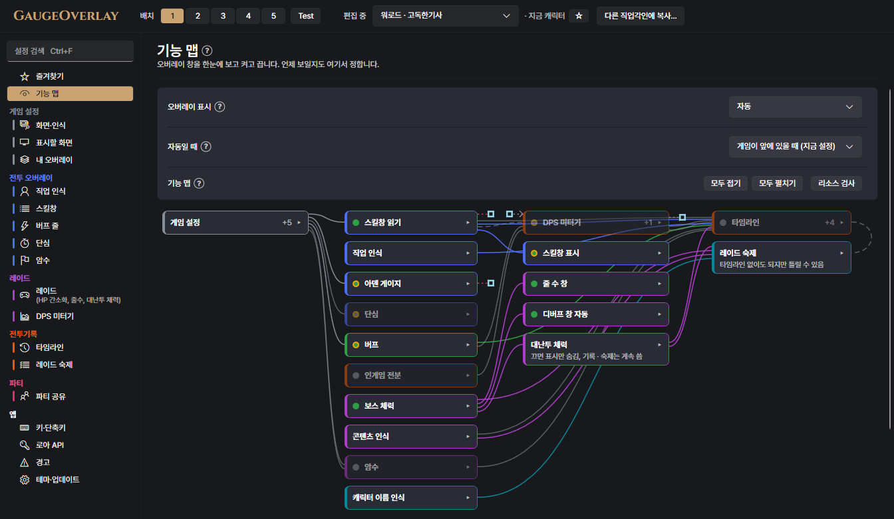
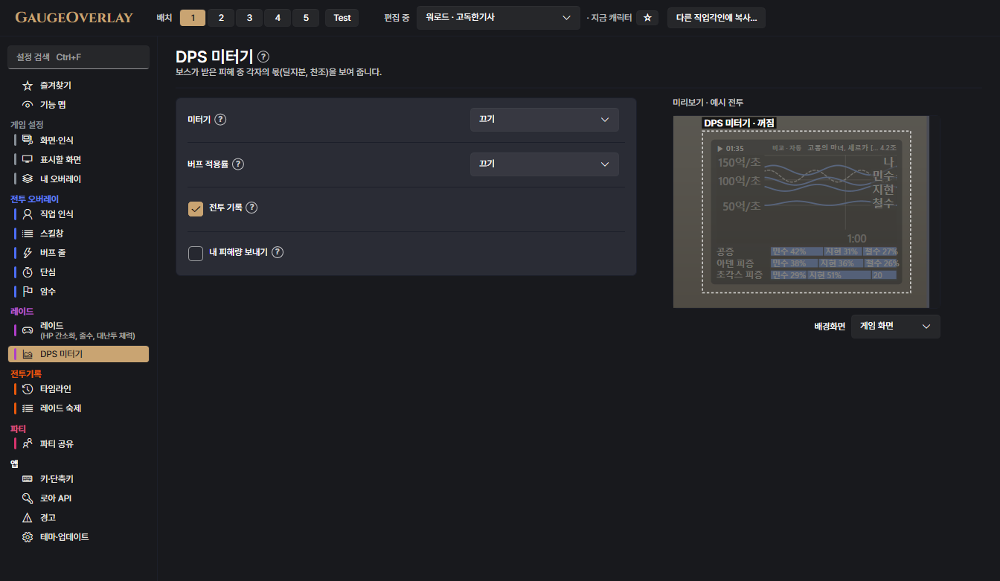

# GaugeOverlay

*캐릭터 아래가 내 오버레이(아덴 게이지, 스킬 칸, 버프 막대), 그 위가 단심 막대, 오른쪽이 파티원 창, 오른쪽 아래가 레이드 디버프 창입니다.*

로스트아크(KR) 화면을 읽어 스킬 쿨타임, 아덴 게이지, 버프, 보스 디버프를 캐릭터 가까이에 작게 보여 주는 Windows 앱입니다. 파티원과 연결하면 서로의 쿨타임과 딜 지분을 보고, 레이드 전투는 캐릭터마다 기록으로 남습니다.

> [!IMPORTANT]
> 화면의 픽셀만 읽습니다. 게임 파일, 메모리, 패킷은 건드리지 않고 게임에 입력을 보내지도 않습니다. 사용에 따른 책임은 사용자에게 있습니다.

## 받기

1. [Releases](../../releases/latest)에서 `GaugeOverlay-v0.23.2.zip`을 받아 원하는 폴더에 풉니다.
2. `GaugeOverlay.exe`를 실행합니다. 설치 과정도, .NET 설치도 필요 없습니다.
3. "Windows의 PC 보호" 창이 뜨면 **추가 정보 → 실행**을 누릅니다. 코드 서명이 없는 프로그램이라 뜨는 창입니다.

필요한 것: Windows 10 2004 이상 또는 Windows 11 (64비트), 로스트아크 한국 서버. 파티 호스트는 공유기에서 UDP 47800 포트를 열어야 합니다(참가만 하면 필요 없음).

새 버전은 앱을 켤 때 알아서 받아 설치합니다. 받은 파일은 SHA-256으로 확인하고, 설정과 기록은 그대로 남습니다.

## 처음 켤 때

안내 창이 세 단계로 열립니다.

1. **키 설정:** 게임 기본 키가 채워져 있습니다. 게임에서 바꾼 키만 고칩니다.
2. **캐릭터:** 클래스와 직업각인을 고릅니다. 나중에는 앱이 스킬창을 보고 알아서 찾습니다.
3. **스킬창 맞추기:** 모든 스킬이 준비된 상태에서 **맞추기**를 누르면 스킬창의 위치와 크기를 찾습니다.

그다음 게임의 **버프 크기**, **보스 디버프 크기**, **데미지 폰트 크기**를 설정 → 화면·인식 → 게임 설정 값에서 게임과 같게 맞춥니다. 이 셋은 앱이 찾지 않으며, 다르면 버프·암수·단심을 읽지 못합니다.

앱은 창을 닫아도 작업 표시줄 알림 영역(시계 옆 ^)에서 계속 실행됩니다. 트레이 아이콘을 두 번 누르면 설정이 열립니다.

## 보여 주는 것

| 기능 | 내용 |
|---|---|
| 스킬 쿨타임 | 각성기, 초각스, 일반 8칸, 아덴스킬 칸. 남은 초와 차오르는 칸, 준비되면 반짝임. 색 대신 게임 아이콘으로도 그림 |
| 아덴 게이지 | 구간 구분선과 빛나는 조건을 직업각인마다 따로 ([지원 클래스](#지원-클래스)) |
| 버프 막대 | 공증, 아덴 피증, 초각스 피증, 초각성기 뎀증의 남은 시간 |
| 단심 | 단죄·심판 룬. 단죄 3초, 심판 6초, 다시 터질 때까지 24초 |
| 암흑수류탄 | 보스에게 건 암수(20초)·빛암(25초)의 남은 시간. 모든 보스 |
| 레이드 | 보스 체력 간소화, 줄 수 알림, 대난투 체력, 모르둠 디버프 창 |
| DPS 미터기 | 딜지분 / 찬조 %, 피해량, DPS 그래프, 버프 적용률. 게임의 전투 분석기를 읽음 |
| 전투 기록 | 전투마다 DPS 그래프, 내 스킬 사용, 버프 유지율, 암수 구간. 두 전투 비교, 휴지통과 보관 |
| 레이드 숙제 | 캐릭터마다 이번 주 클리어한 레이드. 미터기를 꺼도 보스 체력 바를 보고 클리어를 셈 |
| 파티 공유 | 최대 8명이 토큰으로 연결해 쿨타임, 아덴 게이지, 딜 지분을 봄. 연결은 암호화 |

*전투 기록을 연 화면: 위는 파티원의 초당 피해(실선)와 누적 피해(점선), 아래는 내 스킬, 버프 유지, 암수 구간.*

보여 주지 않는 것: 침묵·마나 부족 같은 사용 불가 상태, 파티원의 버프·디버프·단심, 화면에 보이지 않는 정보.

## 설정

설정은 **기능 맵**에서 시작합니다. 앱이 읽는 것(왼쪽)이 어떤 창과 기록(오른쪽)으로 이어지는지 선으로 보입니다. 상자를 누르면 그 설정으로 가고, 마우스를 올리면 그 창이 움직이는 모습을 보여 줍니다. 무언가를 끄면 그것을 쓰는 기능이 함께 흐려져서, 무엇이 멈추는지 미리 압니다. **리소스 검사**는 상자마다 CPU와 GPU를 보여 줍니다.

각 설정 페이지 오른쪽에는 그 창의 미리보기가 예시 전투로 움직입니다. 누르거나 Space를 누르면 다음 장면으로 넘어가고, 아래 **위치 조정**으로 게임 화면 위 자리를 맞춥니다.

- 왼쪽 목록은 게임 설정 · 전투 오버레이 · 레이드 · 전투기록 · 파티 · 앱으로 묶여 있습니다. 새로 생긴 항목에는 노란 점이 붙습니다.
- **Ctrl+F**로 설정을 찾고, **Ctrl+Z / Ctrl+Y**로 되돌립니다. 기본값과 다른 줄에는 ↺가 붙어 바로 되돌립니다.
- 설정은 직업각인마다 따로 둡니다. 맨 위 **편집 중**에서 고칠 직업각인을 고르고, **위치 프로필 1–5**로 창 위치를 바꿔 씁니다.
- **화면·인식 → 감지**에서 항목마다 지금 읽히는지(✓ / !)와 그때의 화면을 봅니다. 잘못 읽히면 여기서 상자를 직접 옮깁니다.

### 단축키

| 동작 | 기본 키 |
|---|---|
| 오버레이 보이기 / 숨기기 | Ctrl+Shift+H |
| 편집 모드 (끌어서 옮기고 크기 조절) | Ctrl+Shift+E |
| 스킬창 다시 맞추기 | Ctrl+Shift+D |
| 테스트 모드 | Ctrl+Shift+T |

설정 → 키·단축키에서 바꿉니다. 해상도나 HUD 크기를 바꾸면 스킬창을 다시 맞추면 됩니다. 해상도마다 따로 저장해서, 전에 맞춘 해상도로 돌아가면 다시 할 필요가 없습니다.

### 파티

1. 호스트가 설정 → 파티 공유에서 **호스트 시작**을 누르고 **토큰 복사**로 토큰을 파티 채팅에 붙여 넣습니다.
2. 참가자는 토큰을 붙여 넣고 **참가**를 누릅니다. 처음 보는 기기는 호스트가 허용해야 들어옵니다.

버전의 앞 두 숫자(0.20)가 같아야 함께 쓸 수 있습니다. 딜 지분은 나와 파티원이 모두 **내 피해량 보내기**를 켰을 때만 보입니다.

## 지원 클래스

모든 클래스(30개)에서 스킬 쿨타임, 버프, 단심, 암수, 미터기, 전투 기록, 파티 공유가 동작하고, **직업각인 자동 인식**도 됩니다. 아래 클래스는 아덴 게이지와 아덴스킬 칸까지 보입니다.

| 클래스 | 직업각인 | 아덴 게이지 | 아덴스킬 칸 |
|---|---|---|---|
| 워로드 | 고독한기사 | 기본 막대 | 아덴2 |
| 워로드 | 전투태세 | 50% 구분선, 아덴스킬을 쓸 수 있으면 빛남 | 아덴2 (게이지가 모자라면 어둡게) |
| 발키리 | 빛의기사 | 다 차고 C가 준비되면 빛남 | Z, C (게이지가 모자라면 어둡게) |
| 발키리 | 해방자 | 80% 구분선, 80% 이상이고 Z가 준비되면 빛남 | Z, C (게이지가 모자라면 어둡게) |
| 바드 | 절실한구원 | 4구간, 다 찬 구간마다 빛남 | 아덴1, 아덴2 |
| 바드 | 진실된용맹 | 3구간, 다 찬 구간마다 빛남 | 아덴1, 아덴2 |
| 도화가 | 만개 · 회귀 | 3구간, 다 찬 구간마다 빛남 | 아덴1, 아덴2 |

워로드는 쿨을 초기화하는 아크 그리드 코어(고독한기사 해 3, 전투태세 해 2)도 설정 → 직업 인식 → 코어 빌드에서 켜면 바로 읽습니다. 다른 클래스의 게이지를 원하시면 [클래스 추가 요청 안내](docs/class-request.md)를 보고 자료를 보내 주세요.

## 동작 방식과 사용량

윈도우가 모니터로 보내는 화면을 그래픽카드에서 그대로 받아옵니다(OBS 녹화와 같은 방식). 그중 스킬창, 버프 줄, 보스 체력바 같은 필요한 부분만 잘라 색과 숫자 모양을 비교합니다. 숫자가 바뀔 때쯤에만 자주 읽고, 게임이 꺼지면 멈춥니다. 끈 기능은 읽지 않습니다.

| 상태 | CPU | GPU | 메모리 |
|---|---|---|---|
| 게임 중 | 약 1–2% | 약 1–2% | 약 150–200MB |
| 게임이 꺼져 있을 때 | 0.1% 미만 | 0% | 약 150–200MB |

*Ryzen 5 5600X, RTX 3070, 1920×1080에서 잰 값입니다.*

인터넷은 업데이트 확인, 파티 연결, 그리고 직접 키를 넣었을 때의 로아 API(원정대 캐릭터 불러오기)에만 씁니다.

## 알아 둘 점

- 쿨타임만 읽습니다. 쓸 수 없는 상태(침묵, 마나 부족)는 표시하지 않습니다.
- 숫자를 잠시 못 읽는 동안은 추정으로 표시하고 점선 테두리로 구분합니다. 다시 읽히면 바로 고쳐집니다.
- 지원 화면: 1920×1080, 2560×1440, 4K, 21:9, 강제 21:9, 창 모드 / HUD 80–110%.
- 암수 남은 시간은 화면에서 아이콘과 글자가 충분히 커야 읽습니다. 1920×1080에서 **보스 디버프 크기** 90%는 암수가 걸린 것만 보이고 남은 시간은 안 보이며, 80%는 암수를 읽지 않습니다. 100% 이상을 쓰세요. 2560×1440 이상에서는 80%부터 남은 시간까지 읽습니다.
- **테스트 모드**(Ctrl+Shift+T)는 유튜브 영상 같은 다른 창을 게임처럼 읽습니다. 같은 화면이면 게임이든 영상이든 똑같이 읽는다는 것을 직접 확인할 수 있습니다.
- 파티 호스트가 통신사 CGNAT 뒤에 있으면 참가자가 들어올 수 없습니다. 다른 사람이 호스트를 맡아 주세요.
- 설정은 `%APPDATA%\GaugeOverlay\settings.json`에 있습니다. 복사하면 다른 PC에서도 같은 설정을 씁니다.
- 지금은 **베타**(0.x)입니다. 기능과 설정이 바뀔 수 있습니다.
