# GaugeOverlay

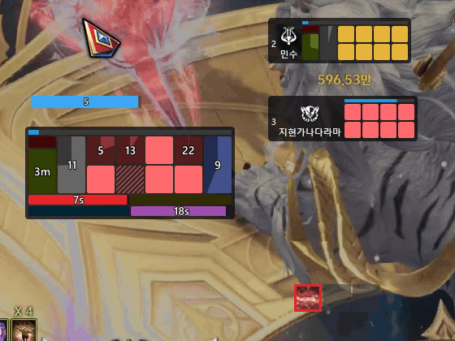

*캐릭터 아래가 내 오버레이(아덴 게이지, 스킬 칸, 버프 막대), 그 위가 단심 막대, 오른쪽이 파티원 창, 오른쪽 아래가 레이드 디버프 창입니다.*

로스트아크(KR)의 스킬창을 화면에서 읽어 스킬 쿨타임, 아덴 게이지, 버프, 레이드 디버프, 보스에 걸린 암흑수류탄을 캐릭터 가까이에 작은 오버레이로 보여 주는 Windows 앱입니다. 파티원끼리 연결하면 서로의 쿨타임과 딜 지분도 볼 수 있고, 레이드 전투는 캐릭터마다 기록으로 남습니다.

- 화면의 픽셀만 읽습니다. 게임 파일, 메모리, 패킷은 건드리지 않고, 게임에 입력을 보내지도 않습니다. 키보드는 앱 자체 단축키에만 씁니다.
- 쿨타임만 감지합니다. 침묵, 마나 부족처럼 스킬을 쓸 수 없는 상태는 표시하지 않습니다.
- 사용에 따른 책임은 사용자에게 있습니다.
- 지금은 **베타**(0.x)입니다. 기능과 설정이 바뀔 수 있습니다.

## 한눈에

| | |
|---|---|
| 보여 주는 것 | 스킬 쿨(각성기, 초각스, 일반 8칸, 아덴 스킬), 초각기 표시, 아덴 게이지, 버프 4종, 레이드 디버프(모르둠), 암흑수류탄·빛암, 단심, 파티원 쿨, DPS 미터기, 레이드 줄 수, 전투 기록 |
| 보여 주지 않는 것 | 침묵·마나 부족 같은 사용 불가 상태, 파티원의 버프·디버프·단심, 화면에 안 보이는 정보 |
| 클래스 | 모든 클래스에서 쿨·버프·파티. 아덴 게이지는 워로드, 발키리, 바드, 도화가 ([표](#지원-클래스)) |
| 아크 그리드 코어 | 쿨 초기화 코어 일부 (워로드 고독한기사 해 3, 전투태세 해 2) |
| 화면 | 1920×1080, 2560×1440, 4K, 21:9, 강제 21:9 / HUD 80–110% / 버프 크기 80–120% / 보스 디버프 크기 80–120% |
| 업데이트 | 앱을 켤 때 자동으로 (설정의 버튼으로도). 받은 파일은 SHA-256으로 확인 |
| 사용량 | 게임 중 CPU 1–2%, GPU 1–2% (Ryzen 5 5600X, RTX 3070, FHD) ([아래](#사용량)) |

## 기능

- **스킬 쿨타임:** 각성기, 초각스, 일반스킬 8칸, 아덴스킬 칸의 남은 시간을 게임 화면의 숫자에서 읽어, 칸이 시계 방향으로 차오르는 모습과 남은 초로 보여 줍니다. 준비되면 한 번 반짝이고, 원하면 준비된 동안 계속 빛나게 할 수 있습니다. 칸을 색 대신 게임의 스킬 아이콘으로 그릴 수도 있습니다.
- **초각기 표시:** 각성기 게이지가 차서 게임에 뜨는 변화 표시를 따로 보여 줍니다.
- **아덴 게이지:** 지원하는 직업각인은 게이지를 오버레이 위쪽 막대로 보여 줍니다. 구간 구분선, 구간별 색, 빛나는 조건을 직업각인마다 정할 수 있습니다.
- **직업각인 감지:** 스킬창 다시 맞추기(Ctrl+Shift+D)를 누르면 클래스와 직업각인을 스킬창에서 알아봅니다. 로딩이나 컷신 뒤에 저절로 바꾸지 않습니다. 설정한 클래스와 화면이 다르면 게이지가 빨갛게 깜빡이고 알려 주며, 10초 안에 고치지 않으면 기본으로 돌아갑니다.
- **버프 막대:** 공증, 아덴 피증, 초각스 피증, 뎀증의 남은 시간을 막대로 보여 줍니다. 판 아래, 분리된 창, 세로 중에 고릅니다. 파티원에게는 보내지 않습니다.

  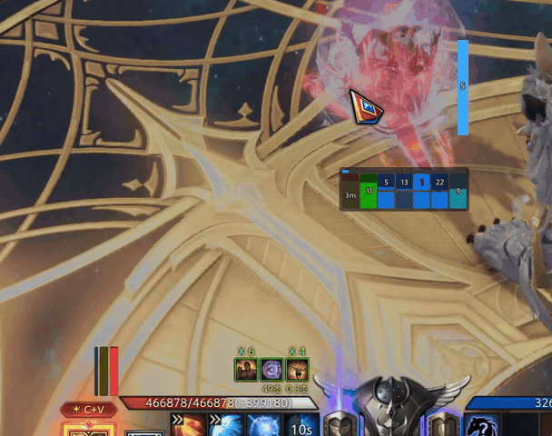

  *세로 배치 예시: 스킬 칸은 캐릭터 바로 아래, 세로 버프 막대(분리된 창)는 HP 바 옆, 세로 단심 막대는 캐릭터 오른쪽, 디버프는 끔. 창마다 따로 옮기고 크기를 바꿉니다.*
- **레이드 줄 수 창 (베타, 실제 레이드 화면으로는 아직 확인 전):** 보스 체력바 위의 이름과 최대 HP로 레이드·관문을 알아보고(자동 인식, 또는 트레이·설정에서 관문을 직접 고름), 체력바 오른쪽 끝의 줄 수(X 494)를 따로 된 창에 보여 줍니다. 관문마다 알림 줄 수를 넣으면 그 줄 수(± 줄 보정 포함)가 될 때 창이 금색으로 빛납니다(정한 초 동안, 또는 정한 줄만큼 지날 때까지). 숫자로 보이거나 게임 화면 그대로 보입니다. 알아보지 못한 보스에는 아무것도 띄우지 않습니다. 설정 → **레이드**에서 관문마다 줄 수 창과 디버프 창을 켭니다. **HP 변경 감지:** 패치로 보스 최대 HP가 바뀌면 다음 레이드에서 새 HP를 배워 관문을 계속 알아보고, 배운 HP는 설정 → 레이드에서 봅니다.
- **디버프 (레이드, 베타):** 설정 → 레이드에서 관문의 디버프 창을 켜면(지금은 3막 3관문 모르둠, 자동이면 모르둠을 알아본 동안만) 따로 된 디버프 창에 내 색(빨강/파랑), 교체 때 데려갈 인원(보스 아래 빨강·파랑 숫자가 반반이 되도록 자동 계산), 번개 디버프(깜빡이며 남은 초)를 보여 줍니다. 번개 칸에는 결투자 디버프도 보입니다(4에서 0까지 카운트다운 뒤 아이콘, 처음 보인 뒤 30초 동안 유지, 컷신이 끝나고 다시 보여도 카운트다운은 한 번만). 보스 숫자는 7을 뺀 0–8을 읽습니다(7은 다른 색 숫자로 계산).

  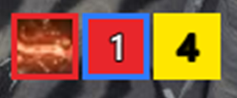

- **암흑수류탄 / 빛암 창 (베타):** 보스 체력바 아래 디버프 줄에서 암흑수류탄(20초)과 빛나는 암흑수류탄(25초)을 찾아, 둘 중 오래 남은 쪽의 시간을 따로 된 창에 보여 줍니다. 모든 보스에서 읽고, 내 화면에만 보입니다. 아래 [암흑수류탄](#암흑수류탄)에서 자세히 설명합니다.
- **단심 (단죄·심판 룬, 베타):** 심판이 켜진 6초와 다시 터질 수 있을 때까지의 24초를 보여 줍니다. 아래 [단심](#단심)에서 자세히 설명합니다.
- **아크 그리드 코어 (선택):** 코어 효과로 쿨이 초기화되는 스킬을 더 빨리 읽습니다. 아래 [코어 빌드](#코어-빌드)에서 설명합니다.
- **비었을 때 숨기기:** 버프 막대, 디버프 칸, 단심 막대는 각각 켜 두면 비어 있는 동안 사라집니다. 다른 막대와 칸은 자리를 그대로 지킵니다.
- **DPS 미터기 (베타):** 보스가 받은 피해 중 각자의 몫을 따로 된 창에 보여 줍니다. 딜러는 딜지분 %, 서포터는 찬조 %이고, 전분(전투분석기)이 기록을 시작한 때부터 셉니다. 범위는 나 / 파티(4) / 공대(8) / 1·2파티, 수치는 지분 % / 피해량 / DPS, 표시 방식은 선 그래프(기본) · 행 · 세로 막대 · 한 줄 막대 · 파티 비교입니다. 선 그래프는 딜러마다(그리고 혼자이거나 서포터여도 나는 항상) 시간에 따른 DPS를 그립니다. 행에는 10초 전보다 오르내린 ▲▼, 기타(보이는 딜러 몫이 아닌 나머지), DPS 그래프를 더할 수 있습니다. 맨 아래 **버프 적용률**은 내 피해 중 공증 · 아덴 피증 · 초각스 피증이 켜져 있을 때 넣은 비율을 막대 셋으로 보여 줍니다(1초마다 새로 들어온 피해를 그 1초 중 버프가 켜져 있던 만큼 나누는 어림값이고, 설정 → 버프가 켜져 있어야 합니다). 서포터일 때는 대신 **버프 분배**가 보입니다(보내기를 켠 딜러가 둘 이상일 때): 버프마다 그 버프가 켜진 동안 딜러들이 넣은 피해 전체를 100%로 놓고 딜러별로 나눠, 누가 그 버프를 가장 잘 썼는지 보여 줍니다. 서포터 자신은 들어가지 않습니다(아덴 · 초각스 피증은 파티 공통이라 내 화면의 시간으로, 장판형이 있는 공증은 각자 보낸 값으로 셉니다). 켜기 아래에서 **미터기 창 보이기**와 **전투 기록**을 따로 켜고 끕니다. 파티원 몫은 나와 그 파티원이 모두 **내 피해량 보내기**를 켰을 때만 보이고(보내지 않으면 받지도 않습니다), 모두 같은 보스 수치로 나누므로 누구에게나 같은 숫자가 보입니다. 피해량이 1천만을 넘기 전에는 '–'로 보입니다. 전분 창은 전투 중에 화면에서 자동으로 찾아 게임 화면 크기마다 기억합니다(옮겨도 다시 찾습니다). 한두 번 못 읽으면 마지막 수치를 5초까지 그대로 두어 깜빡이지 않고, 컷신처럼 오래 가려지면 '전분 없음'이 보입니다. 이 앱의 다른 창이 전분 창을 덮으면 읽지 못하니 겹치지 않게 두세요. DPS 미터기와 줄 수 창은 보스를 읽는 동안만 보이고, 보스가 사라지면 10초 뒤 숨었다가 보스가 다시 보이면 바로 나타납니다(편집 모드와 설정에서는 늘 보입니다). 설정 → **DPS 미터기**에서 켭니다.
- **전투 기록 (베타):** DPS 미터기가 따라간 전투를 캐릭터마다 자동으로 저장합니다(자동 기록은 캐릭터마다 1~50개 중 고른 개수만 남기고 가장 오래된 것부터 지웁니다(기본 50개). **보관**한 기록은 개수에 들지 않고 지울 때까지 남습니다. 파일 이름에 날짜 · 시간, 레이드 · 관문, 난이도, 클래스가 들어갑니다. 레이드 이름과 난이도(싱글 · 노말 · 하드 · 나이트메어, EX)는 왼쪽 위 던전 창에서 Windows 기본 글자 인식으로 읽고, 보스 최대 HP(관문 · 난이도마다 다름)와 함께 기억해 두었다가 다음부터는 HP로 이름을 붙입니다. 너프 등으로 HP가 바뀌면 새로 기억합니다. 가디언 토벌은 매일 하는 콘텐츠라 저장하지 않습니다). 레이드에 들어가 전분 타이머가 움직이면 자동으로 시작하고, 보스 HP가 10,000 아래인 채 타이머가 멈추면 **클리어**로, 전멸 · 컷신 등으로 타이머가 멈추거나 가려진 채 **멈춤 허용**(기본 120초)이 지나면 **실패**로, 재시작으로 전분이 새로 시작되면 앞 전투를 저장하고 새로 기록합니다. **자동 저장**을 끄면 마지막 전투 하나만 '저장 안 됨'으로 남고 보관을 눌러야 저장됩니다. 전분이 잠깐 가려져도 미터기는 마지막 수치와 그래프를 '전분 가려짐'으로 보여 줍니다. 열면 파티원 모두의 DPS(실선)와 누적 피해(점선)를 한 그래프로 비교하고, 그 아래에 내 스킬 사용 시점(스킬 아이콘)을 한 줄로, 맨 아래에 내 공증 · 아덴 피증 · 초각스 피증이 켜진 구간과 유지율(%)을 보며, 페이즈 경계도 표시합니다. 암수 읽기를 켜고 기록한 전투는 보스에 암수가 걸린 구간을 한 줄 더 보여 주고, 위쪽에 **암수 이득**(암수가 걸린 동안 넣은 피해의 10.35%, 나 · 전체)을 적습니다. 지금 캐릭터의 스킬 아이콘이 없으면 타임라인 위의 **스킬 등록**으로 바로 등록합니다. 마우스를 올리면 그 초의 피해량 · 초당 피해량(게임의 전투 분석기처럼 전체 숫자), 켜진 버프, 쓴 스킬이 나옵니다. 다른 파티원의 스킬 사용은 기록하지 않습니다. 휠로 확대하고 끌어서 옮깁니다. **비교**로 두 기록을 한 시간 축에 겹쳐 봅니다(전투 시작 또는 고른 페이즈 시작에 맞춤). 전분 타이머가 멈춘 동안에는 아무것도 기록하지 않습니다. 파티원에게 새로 보내는 것은 없습니다. 설정 → **전투 기록**에서 캐릭터를 골라 봅니다.

  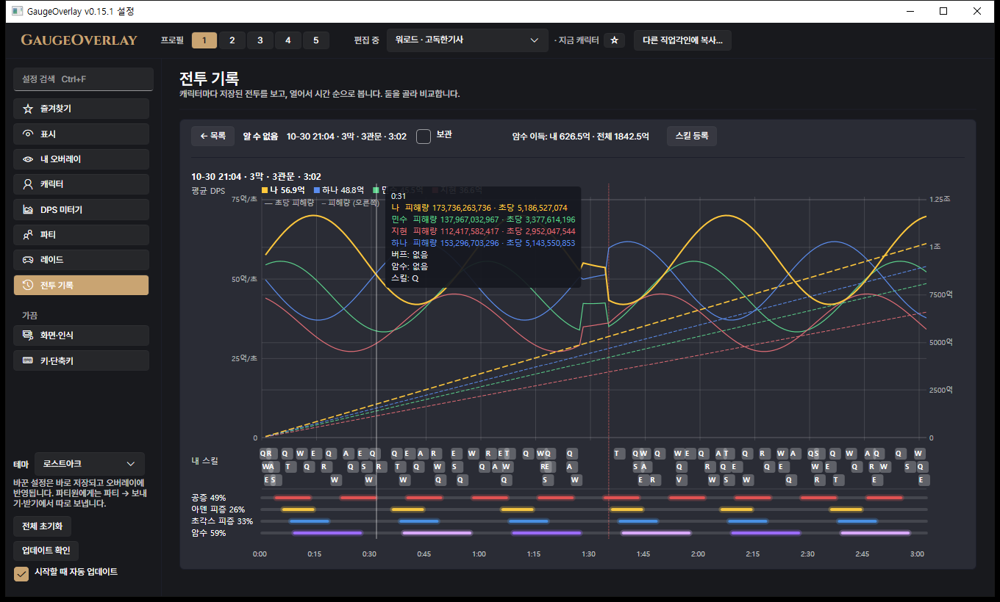

  *기록을 연 화면: 위는 파티원의 초당 피해(실선)와 누적 피해(점선), 아래는 내 스킬, 버프 유지, 암수 구간. 마우스를 올린 초의 수치가 나옵니다.*
- **파티 공유:** 호스트 1명과 최대 7명(공대 8명; 파티원 창에는 내 파티 3명만)이 토큰으로 연결해 서로의 쿨타임, 초각기 표시, 아덴 게이지를 봅니다. 연결은 암호화됩니다. 파티원 칸의 색·크기·배치는 내 설정으로 칠하거나 파티원이 보낸 것을 받아 쓸 수 있습니다.
- **클래스별 설정:** 내 칸은 직업각인마다, 파티원 칸은 클래스마다 표시할 것, 칸 배치, 색을 따로 둘 수 있습니다.
- **설정 화면에서 바로 배치:** 설정 → 내 오버레이의 게임 화면 위에 모든 창을 실제 위치에 그려 놓고 맞춥니다. 칸 하나하나를 옮기거나 크기를 바꿀 수도 있습니다. 왼쪽 위 **화면 정보 상자**에서 게임의 해상도, 화면 비율, HUD 크기를 보고, 버프·디버프 크기와 보스 디버프 크기를 바로 바꿉니다.
- **표시:** 설정 → 표시에서 모든 창을 모아 한 장면으로 보고 하나씩 켜고 끕니다. 오버레이가 언제 보일지(게임·설정이 앞에 있을 때, 항상, 끄기)도 여기서 정합니다.
- **오버레이 프로필 5개:** 창 위치·크기와 판 색을 프로필마다 저장하고 트레이나 단축키로 바꿉니다.
- **화면 캡처에서 숨기기:** OBS, 디스코드 화면 공유에 오버레이가 찍히지 않게 할 수 있습니다.
- **테스트 모드:** 게임이 아닌 창(유튜브 영상 등)을 게임으로 보고 인식을 시험합니다. 아래 [테스트 모드](#테스트-모드)를 보세요.

## 지원 클래스

모든 클래스에서 쿨타임(각성기, 초각스, 일반스킬 8칸), 버프 막대, 단심, 파티 공유가 동작합니다. 아래 표의 직업각인은 여기에 더해 아덴 게이지, 아덴스킬 칸, 직업각인 자동 감지까지 모두 지원합니다.

| 클래스 | 직업각인 | 아덴 게이지 | 아덴스킬 칸 | 아크 그리드 코어 |
|---|---|---|---|---|
| 워로드 | 고독한기사 | 기본 막대 | 아덴2 | △ 3xx (해 3) |
| 워로드 | 전투태세 | 50% 구분선, 아덴스킬을 쓸 수 있으면 빛남 | 아덴2 (게이지가 모자라면 어둡게) | △ 2xx (해 2) |
| 발키리 | 빛의기사 | 다 차고 C가 준비되면 빛남 | Z, C (게이지가 모자라면 어둡게) | – |
| 발키리 | 해방자 | 80% 이상이고 Z가 준비되면 빛남 | Z, C (게이지가 모자라면 어둡게) | – |
| 바드 | 절실한구원 | 4구간, 다 찬 구간마다 빛남 | 아덴1, 아덴2 | – |
| 바드 | 진실된용맹 | 3구간, 다 찬 구간마다 빛남 | 아덴1, 아덴2 | – |
| 도화가 | 만개 | 3구간, 다 찬 구간마다 빛남 | 아덴1, 아덴2 | – |
| 도화가 | 회귀 | 3구간, 다 찬 구간마다 빛남 | 아덴1, 아덴2 | – |

나머지 클래스는 아덴 게이지와 아덴스킬 칸 없이 표시됩니다. 파티원 창에는 30개 클래스 모두 클래스 아이콘이 나옵니다.

앱 안에서는 설정 → 캐릭터 아래 **지원하는 직업각인** 표에서 직업각인마다 지원하는 기능을 볼 수 있습니다. 표는 직업군별로 나뉘고, 업데이트로 새로 추가된 직업각인이나 기능은 그 화면을 한 번 볼 때까지 맨 위 **새로 추가됨**에 **NEW**를 달고 나옵니다.

### 클래스별 지원 단계

클래스는 단계별로 추가합니다. ✓ = 지원, △ = 일부만 지원, – = 아직 없음.

코어는 해·달·별 레벨을 차례로 적습니다(3xx = 해 3, x2x = 달 2). 아크 그리드 코어는 **화면에 보이는 것이 달라지는 코어**(스킬 쿨 초기화 등)만 셉니다. 피해량만 바뀌는 코어는 앱이 따로 할 일이 없어 넣지 않습니다. △는 그 클래스에서 화면이 달라지는 코어 중 일부만 지원한다는 뜻입니다.

| 직업군 | 클래스 | 1. 직업각인 감지 | 2. 아덴 게이지 | 3. 아덴 스킬 | 4. 아크 그리드 코어 |
|---|---|:-:|:-:|:-:|:-:|
| 워리어 | 워로드 | ✓ | ✓ | ✓ | △ |
| 워리어 | 홀리나이트 | ✓ | – | – | – |
| 워리어 | 버서커 | ✓ | – | – | – |
| 워리어 | 디스트로이어 | – | – | – | – |
| 워리어 | 가디언나이트 | – | – | – | – |
| 워리어 | 발키리 | ✓ | ✓ | ✓ | – |
| 워리어 | 슬레이어 | ✓ | – | – | – |
| 무도가 | 배틀마스터 | – | – | – | – |
| 무도가 | 인파이터 | – | – | – | – |
| 무도가 | 기공사 | – | – | – | – |
| 무도가 | 창술사 | – | – | – | – |
| 무도가 | 스트라이커 | – | – | – | – |
| 무도가 | 브레이커 | – | – | – | – |
| 헌터 | 데빌헌터 | – | – | – | – |
| 헌터 | 블래스터 | – | – | – | – |
| 헌터 | 호크아이 | – | – | – | – |
| 헌터 | 스카우터 | – | – | – | – |
| 헌터 | 건슬링어 | – | – | – | – |
| 마법사 | 바드 | ✓ | ✓ | ✓ | – |
| 마법사 | 서머너 | – | – | – | – |
| 마법사 | 아르카나 | – | – | – | – |
| 마법사 | 소서리스 | – | – | – | – |
| 암살자 | 블레이드 | – | – | – | – |
| 암살자 | 데모닉 | – | – | – | – |
| 암살자 | 리퍼 | – | – | – | – |
| 암살자 | 소울이터 | – | – | – | – |
| 스페셜리스트 | 도화가 | ✓ | ✓ | ✓ | – |
| 스페셜리스트 | 기상술사 | – | – | – | – |
| 스페셜리스트 | 환수사 | – | – | – | – |
| 스페셜리스트 | 차원술사 | ✓ | – | – | – |

지원되지 않는 클래스나 코어를 플레이하신다면 [클래스 추가 요청 안내](docs/class-request.md)를 보고 자료를 보내 주세요. 준비된 단계부터 하나씩 추가합니다.

## 필요한 것

- Windows 10 2004 이상 또는 Windows 11 (64비트).
- 로스트아크 한국 서버 클라이언트.
- 파티 호스트를 하려면 공유기에서 UDP 47800 포트(바꿀 수 있음)를 열어 두어야 합니다. 참가만 할 때는 필요 없습니다.

## 설치

1. 이 저장소의 **Releases**에서 `GaugeOverlay-v0.15.3.zip`을 받습니다.
2. 원하는 폴더에 압축을 풉니다. `GaugeOverlay.exe`와 `Profiles` 폴더가 같은 곳에 있어야 합니다.
3. `GaugeOverlay.exe`를 실행합니다. 설치 과정은 없고 .NET도 따로 설치할 필요가 없습니다.

처음 실행할 때 "Windows의 PC 보호" 창이 뜨면 **추가 정보 → 실행**을 누르세요. 코드 서명이 없는 프로그램이라 Windows가 한 번 확인하는 것이며, 새 버전을 받을 때마다 다시 뜰 수 있습니다.

설정은 `%APPDATA%\GaugeOverlay\settings.json`에 저장됩니다. 이 파일을 복사하면 다른 PC에서도 같은 설정을 쓸 수 있습니다.

### 업데이트

지금 버전은 설정 창 제목에 나옵니다. 앱이 켜질 때 새 버전이 있으면 알아서 받아 설치하고 다시 켜집니다(0.12.0부터). 켜져 있는 동안에는 새로 확인하지 않으니, 앱을 계속 켜 두었다면 다음에 켤 때 업데이트되거나, 설정 왼쪽 아래 **업데이트 확인**으로 바로 받을 수 있습니다.

- 받은 파일은 함께 올라간 SHA-256 값과 비교해, 같을 때만 설치합니다. 다시 켜지면 바뀐 내용을 한 번 보여 줍니다.
- 설정, 배운 값, 저장된 아이콘은 그대로 남습니다.
- 자동으로 받지 않으려면 설정 왼쪽 아래의 **시작할 때 자동 업데이트**를 끕니다. 그때는 **업데이트 확인**을 눌러 새 버전이 있으면 버튼이 **vX 받기**로 바뀌고, 누를 때만 받습니다.
- **0.12.0을 쓰고 있다면:** 0.12.0은 켜자마자 "GaugeOverlay를 시작하지 못했습니다"로 꺼져서 자동 업데이트도 되지 않습니다. Releases에서 0.12.1 이상을 받아 같은 폴더에 덮어써 주세요. 설정은 그대로 남습니다.
- **큰 업데이트**(앞의 두 숫자가 바뀜, 예: 0.11 → 0.12)는 버튼에 노란 경고 표시가 붙습니다. 파티는 앞의 두 숫자가 같은 버전끼리만 되므로, 파티원도 모두 업데이트해야 합니다. 끝자리만 바뀐 업데이트는 이전 버전과 그대로 파티가 됩니다.

  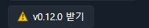

- 알파 버전(1.x)은 베타로 자동 업데이트되지 않으니, v0.9.0 이상을 한 번 직접 받아 주세요.

## 처음 실행

처음 실행하면 세 단계 안내 창이 열립니다.

1. **키 설정:** 게임 기본 키가 채워져 있습니다. 게임에서 바꾼 키만 고칩니다.
2. **캐릭터:** 클래스를 고르면 그 클래스에서 마지막으로 쓴 직업각인이 바로 골라집니다. 처음 고르는 클래스면 직업각인 목록이 열립니다. 클래스 목록은 직업군 제목으로 나뉘어 있습니다.

   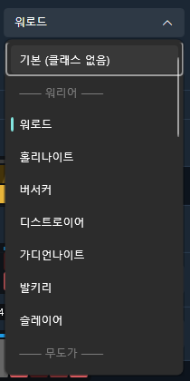

3. **스킬창 맞추기:** 스킬을 쓸 수 있는 곳에서 모든 스킬이 준비된 상태로 둔 뒤(수련장에서는 쿨초) [맞추기]를 누릅니다. 앱이 스킬창의 위치와 크기, 직업각인을 알아냅니다. 게임의 버프 크기와 데미지 폰트 크기는 찾지 않으니 설정 → 화면·인식 → 스킬창에서 게임과 같게 맞춰 주세요(버프 크기 기본 120%).

그 뒤로는 트레이 아이콘과 오버레이만 쓰면 됩니다. 앱은 창을 모두 닫아도 작업 표시줄 오른쪽 알림 영역에서 계속 실행됩니다. 아이콘이 보이지 않으면 시계 옆 ^ 안에 있으니, 시계 옆으로 끌어다 두면 항상 보입니다.

해상도나 HUD 크기를 바꾸면 트레이의 **스킬창 다시 맞추기**(Ctrl+Shift+D)를 스킬을 쓸 수 있는 곳에서 다시 하면 됩니다. 버프 크기를 바꿨으면 설정에서도 바꿔 주세요. 해상도별로 맞춘 값을 따로 저장하므로, 전에 맞춘 해상도로 돌아가면 다시 맞출 필요가 없습니다.

## 사용법

### 트레이 메뉴

트레이 아이콘을 오른쪽 클릭하면 메뉴가, 두 번 클릭하면 설정 창이 열립니다.

- **설정 열기**
- 오버레이 켜기/끄기, 편집 모드, 테스트 모드(맨 앞 창 따라가기, 열린 창 목록, 끄기; 아래 [테스트 모드](#테스트-모드)), 프로필 1–5
- **표시:** 스킬 칸, 아덴 게이지, 버프 막대, 디버프 창, 단심 창, 암수 창, DPS 미터기, 줄 수 창, 파티원 창을 바로 켜고 끕니다
- 캐릭터, 레이드(자동 인식 또는 관문 직접 고르기, 지금 알아본 관문 표시), 파티(호스트 시작, 참가, 토큰 복사, 나가기)
- 스킬창 재맞춤 (+캐릭터 감지), **인식 도구**: 직업각인 다시 감지, 스킬 등록, 아이콘 다시 읽기, 진단
- 종료

### 단축키

| 동작 | 기본 키 |
|---|---|
| 오버레이 표시/숨기기 | Ctrl+Shift+H |
| 편집 모드 (오버레이를 끌어서 옮기고 크기 조절) | Ctrl+Shift+E |
| 스킬창 다시 맞추기 | Ctrl+Shift+D |
| 테스트 모드 | Ctrl+Shift+T |
| 오버레이 프로필 1–5 | 없음 (설정에서 지정) |

단축키는 설정 → 키·단축키 → 앱 단축키에서 바꿉니다. 다른 단축키나 스킬 키와 겹치면 빨간 테두리로 알려 줍니다.

### 설정 창

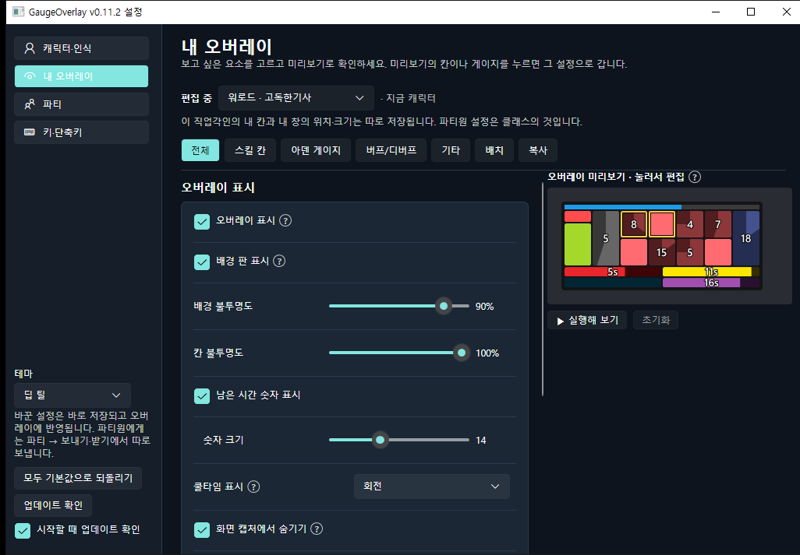

설정은 왼쪽 영역으로 나뉩니다. 바꾼 값은 바로 저장되고 오버레이에 반영됩니다. 화면에는 이름만 나오고, 설명은 이름 옆 **?**에 마우스를 올리거나 Tab으로 가면 나옵니다.

- **즐겨찾기:** ★를 단 설정을 한곳에서 바꿉니다. 설정 행을 오른쪽 클릭하거나 검색 결과의 ☆로 답니다.
- **표시:** 오버레이를 언제 보일지 정하고, 모든 창이 모인 장면을 보며 창마다 켜고 끕니다. 장면의 창을 누르면 그 창의 설정으로 갑니다.

  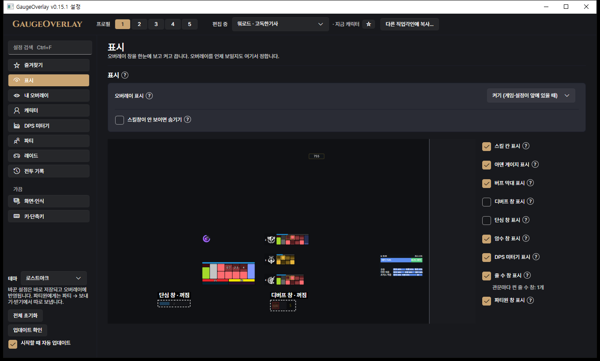

- **내 오버레이:** 가운데에 게임 화면과 오버레이가 실제 위치로 보입니다. 왼쪽 위 상자에 해상도 · 비율 · HUD 크기(자동 / 직접 / 수동 조정, **맞추기** 버튼)가 나오고, 버프·디버프 크기와 보스 디버프 크기를 게임과 같게 고릅니다. 칸이나 게이지를 누르면 오른쪽에 그 설정이 나오고, 끌어서 옮기고, 모서리로 크기를 바꾸고, 화살표 키로 1픽셀씩(Shift는 10픽셀) 움직입니다. 화면 위 도구 막대에서 스크린샷 불러오기, **게임 화면 찍기**, **▶ 시뮬레이션**(칸과 디버프·단심 창이 예시대로 움직임)을 씁니다.
- **캐릭터:** 캐릭터 선택, 직업각인 다시 감지, 코어 빌드.
- **파티:** 연결, 파티원 모양, 순서, 보내기·받기.
- **레이드:** 보스 인식(자동 또는 관문 고르기), 관문마다 줄 수 창·알림 줄 수·디버프 창, 알림 보정(± 줄, 전 관문 공통 또는 관문마다)과 빛나기, 줄 수 창 모양.
- **전투 기록:** 저장된 전투 목록(날짜, 레이드 · 관문, 길이, 파티, 내 몫)과 열기 · 보관 · 비교 · 삭제, 타임라인.
- **DPS 미터기:** 켜기, 내 피해량 보내기(파티 → 보내기·받기에도 있음), 범위·수치·표시 방식, 그래프·서포터·기타, 색과 창, 전분 위치(게임 화면 크기마다). 호스트는 파티 → 순서에서 파티원을 1파티·2파티로 나눕니다.
- **화면·인식:** 스킬창(맞추기, 스킬창 위치, 게임의 버프 크기와 데미지 폰트 크기, 수동 조정, 스킬 등록).
- **키·단축키:** 게임 키, 앱 단축키.

맨 위 막대에서 오버레이 프로필 1–5와 편집 중인 직업각인을 고릅니다. **Ctrl+F**로 설정을 검색하고("크기", "버프크기"처럼 띄어 써도 안 써도 됩니다), **Ctrl+Z / Ctrl+Y**로 되돌리고 다시 합니다.

맨 위의 **편집 중**에서 고칠 직업각인을 고릅니다. 직업각인마다 설정이 따로 있습니다('기본'은 클래스 정보가 없을 때의 설정입니다). 지금 캐릭터가 아닌 직업각인을 고르면 미리보기와 칸 옵션이 그 직업각인을 따르고, 설정을 열어 둔 동안 화면의 내 오버레이도 그 직업각인의 예시로 바뀝니다. 설정을 닫으면 원래대로 돌아옵니다. 파티원 칸의 모양은 클래스마다 하나여서, 같은 클래스의 직업각인이 함께 씁니다.

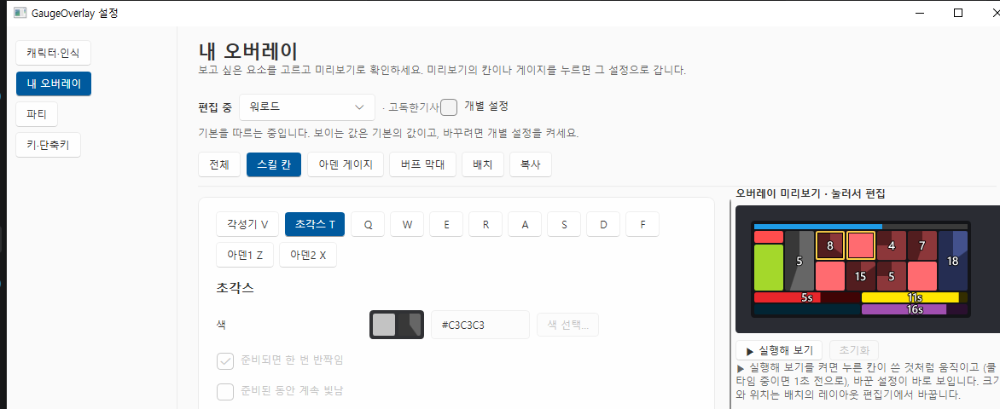

스킬 칸에서는 위의 칩(각성기, 초각스, 스킬 키, 아덴)으로 칸을 고르고, 그 칸만 또는 같은 그룹 전체의 색과 효과를 바꿉니다.

**아이콘으로 표시**를 켜면 칸에 색 대신 게임 화면의 스킬 아이콘을 그립니다. 아이콘은 직업각인마다 저장되며, 저장된 아이콘이 없는 칸이 있을 때만 화면에서 읽습니다. 스킬을 바꿨으면 **아이콘 다시 읽기**(스킬 칸, 트레이, 단축키)를 누르면 모든 칸을 다시 읽습니다.

**쿨타임 중 숨기기**를 켠 칸은 쿨타임 동안 사라졌다가 준비되면 다시 나타납니다. 쿨타임을 확실히 읽지 못한 칸, 사용 횟수가 남은 스택 스킬, 사용 후 3초 유지 숫자는 그대로 보입니다.

설정 창의 색은 왼쪽 아래 **테마**에서 고릅니다: 로스트아크(기본), 그래파이트, 아크라시아 밤, 딥 틸, Windows 설정 따름, 밝게, 어둡게. 0.12.0 전부터 쓰던 설정은 쓰던 테마를 그대로 씁니다.

각 설정 패널 아래의 **기본값**은 그 패널만 되돌리고, 누르면 한 번 더 확인합니다. 왼쪽 아래 **전체 초기화**는 캐릭터, 오버레이 프로필(위치·크기), 창 위치, 배운 게이지 값, 테마를 남깁니다.

### 단심

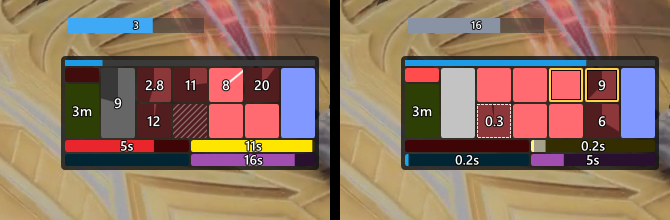

*왼쪽: 심판이 켜져 3초 남음. 오른쪽: 다시 터질 수 있을 때까지 16초 남음.*

단죄·심판 룬의 심판이 켜진 6초와, 다시 터질 수 있을 때까지 남은 24초를 보여 줍니다. 내 단심만 보이고 파티원에게는 보내지 않습니다.

- **막대:** 심판 6초 동안 막대 전체가 줄어들고, 그다음 다시 가득 차서 대기 24초 동안 줄어듭니다. 가로나 세로로 두고, 막대 안에 남은 초를 띄울 수 있습니다. 색(심판, 대기), 길이, 두께, 불투명도를 바꿉니다.
- **아이콘:** 심판이 켜진 동안 아이콘 위에 남은 초를 보여 주고, 다시 터질 수 있게 되면 한 번 번쩍인 뒤 1초에 걸쳐 사라집니다. 대기 중에 흐린 아이콘과 남은 초를 보여 주는 옵션도 있습니다.
- **읽는 방법:** 버프 줄의 심판 아이콘과 그 아래 남은 시간으로 시작 시각을 맞춥니다. 버프가 많아 아이콘이 밀려나면 캐릭터 위의 '심판' 글자를 읽습니다(감지 방식: 아이콘 + 글자 / 아이콘만 / 글자만). 글자를 읽으려면 게임의 **데미지 폰트 크기**(75/100/150/200/300%)를 설정에 맞춰야 합니다. 대기 24초 동안은 화면을 읽지 않고 시계로만 셉니다.

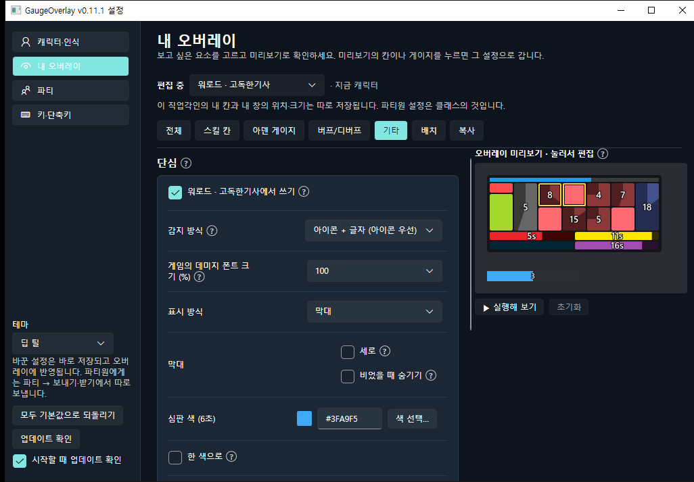

설정 → 내 오버레이 → **기타**에서 직업각인마다 켭니다. 기본은 꺼짐입니다.

### 암흑수류탄

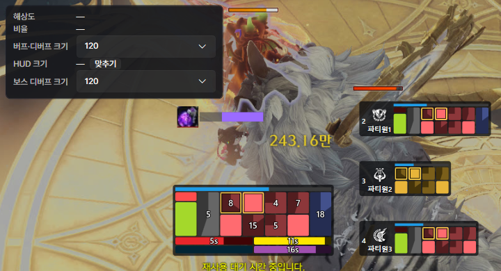

*설정 → 내 오버레이: 왼쪽 위가 화면 정보 상자, 그 아래 보라색 막대가 빛암 창, 가운데가 내 오버레이, 오른쪽이 파티원 창입니다.*

보스에게 건 암흑수류탄(20초)과 빛나는 암흑수류탄(빛암, 25초)을 보스 체력바 아래 디버프 줄에서 찾아, 오래 남은 쪽의 남은 시간을 보여 줍니다. 모든 보스에서 읽고, 파티원에게는 보내지 않습니다.

- **어느 칸이든:** 암수가 디버프 줄의 몇 번째 칸에 있어도 찾고, 앞의 디버프가 끝나 칸이 옮겨 가도 따라갑니다(보스 디버프 크기 80–120%, 줄에 보이는 칸은 14 / 12 / 10개).
- **모양:** 막대(줄어드는 방향 4가지), 원, 숫자(아이콘 옆 또는 위) 중 고르고, 색, 크기, 막대 길이, 불투명도를 바꿉니다. 정한 초(1–10초) 아래로 남으면 경고 색으로 바뀝니다.
- **남은 시간:** 아이콘 아래 "N초"를 읽어 셉니다. 게임은 1초 위로는 초를 버려 보여 주므로(16초 = 16.0–16.9초) 그 범위에 맞춰 셉니다. 글자가 작으면 잘못 읽기 쉬워서, 보스 디버프 크기가 화면에서 100%보다 작으면(게임 화면 높이 1080 기준: 강제 21:9처럼 화면이 낮으면 더 커야 함) 시간은 읽지 않고 걸려 있는 동안 아이콘만 보여 줍니다.
- 디버프가 많아 '+N'으로 밀려나 안 보이면 마지막에 읽은 시간부터 흐리게 계속 셉니다.
- **보스 디버프 크기**를 게임 설정과 같게 맞춰야 합니다. 화면 정보 상자, 암흑수류탄 설정, 디버프 설정 어디서 바꿔도 같은 값입니다.
- 설정 → 내 오버레이에서 암수 창을 누르면 오른쪽에 **암흑수류탄** 설정이 나옵니다(Ctrl+F로 "암흑수류탄" 검색도 됨). 거기서 **암흑수류탄 읽기**를 켜고, 창은 끌어 옮기고 모서리로 크기를 바꿉니다.

### 코어 빌드

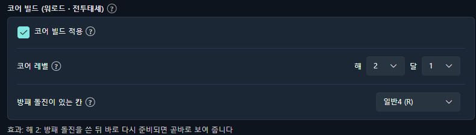

아크 그리드 코어 중 스킬 쿨을 초기화하는 코어는, 코어를 알려 주면 그 스킬 칸을 더 촘촘히 읽어서 초기화가 바로 보입니다. 설정 → 캐릭터의 **코어 빌드**에서 **코어 빌드 적용**을 켜고, 코어 레벨과 해당 스킬이 있는 칸을 고릅니다. 기본은 꺼짐이고, 켜지 않으면 아무것도 달라지지 않습니다. 스킬 칸은 고른 코어 레벨에 그 스킬을 쓰는 효과가 있을 때만 묻습니다. 코어는 화면에서 알아보지 않으며 파티원에게 보내지도 않습니다.

| 클래스 | 직업각인 | 코어 | 효과 | 고를 칸 |
|---|---|---|---|---|
| 워로드 | 고독한기사 | 3xx (해 3) | 버스트 캐넌을 쓰면 C(아덴2)가 초기화되는 것을 바로 읽음 | 버스트 캐넌 |
| 워로드 | 전투태세 | 2xx (해 2) | 증오의 함성 뒤에 쓴 방패 돌진이 바로 다시 준비되는 것을 곧바로 보여 줌 (켜지 않으면 1–3초 동안 쓴 것처럼 보임) | 방패 돌진 |

### 배치 (옛 레이아웃 편집기)

레이아웃 편집기는 0.12.0에서 설정 → **내 오버레이**로 합쳐졌습니다. 내 오버레이, 버프 창, 디버프 창, 단심 창, 파티원 창이 게임 화면 위 실제 위치에 그려지고, 거기서 바로 옮기고 크기를 바꿉니다. **게임 화면 찍기**로 내 게임 화면을 프로필마다 배경으로 씁니다.

### 스킬창 위치: 자동 / 직접 입력 / 수동 조정

설정 → 화면·인식 → 스킬창의 **스킬창 위치**에서 고릅니다.

- **자동** (기본): 화면의 검은 띠와 HP 바로 해상도와 HUD 크기를 찾습니다.
- **직접 입력**: 게임 설정의 해상도와 HUD 크기를 골라 그 값으로 씁니다. 앱은 스킬창이 그 자리에 있는지만 확인합니다.
- **수동 조정**: 위치 조정에서 맞추고 적용한 위치를 씁니다. 화면 크기마다 따로 저장되고, 적용한 적 있는 화면 크기에서만 고를 수 있습니다.

**게임의 버프 크기**는 세 방식 모두에서 보이며 게임 설정과 같게 맞춰야 합니다. 스킬창 다시 맞추기는 버프 크기를 찾지 않으며, 다르면 버프와 디버프를 엉뚱한 곳에서 읽습니다. 120%에서 가장 잘 읽습니다. 바로 아래 **게임의 데미지 폰트 크기**(75/100/150/200/300%)도 게임 설정과 같게 맞춥니다. 단심이 '심판' 글자를 읽을 때 씁니다. 게임 설정에서 확인할 값이 이 탭에 모여 있습니다.

### 위치 조정 (수동 조정)

인식 위치가 어긋날 때 게임 화면 위에서 직접 맞춥니다. 설정 → 화면·인식 → 스킬창 → **위치 조정**을 누르면 게임 화면 위에 읽는 상자가 모두 제자리에 뜹니다(게임이나 테스트 모드의 창이 실행 중일 때).

- 상자는 스킬창(칸마다), 버프 줄, 디버프 줄, 보스 줄입니다. 버프·디버프 줄에는 칸 사이 세로선과 아이콘·시간을 나누는 가로선이, 보스 줄에는 보스 버프와 디버프 사이 '/' 자리에 세로선이 있습니다. 아이콘이 선 사이에 들어오면 맞습니다.
- 잘 읽히는 상자는 **초록색**이 됩니다. 버프·디버프·보스 줄은 그 줄에 읽을 것이 떠 있을 때만 초록색이 됩니다.
- 상자를 끌어 옮기고, 모서리의 네모를 끌어 크기를 바꿉니다. 화살표 키는 1px(Shift: 10px), Alt+↑↓ 또는 + −는 크기, Tab은 다음 상자, Ctrl+Z는 처음 위치로 돌아갑니다.
- 버프 줄과 디버프 줄은 **게임의 버프 크기** 하나를 같이 씁니다. 보스 줄은 % 로 키웁니다(100%가 게임 크기).
- 바꾼 위치는 위치 조정 화면이 열려 있는 동안만 쓰입니다. **적용**(Enter)을 누르면 저장되고, 적용하지 않고 닫으면(Esc) 원래대로 돌아갑니다. 위의 도구 막대는 끌어서 옮길 수 있습니다.
- 맞춘 적이 없는 화면 크기에서는 HUD 100% 자리에서 시작합니다.

### 진단

설정 → 화면·인식 → **진단**(또는 트레이 → 인식 도구 → 진단)에는 스킬 칸, 버프 칸 1–7, 디버프 칸 1–5, 보스 숫자의 화면과 읽은 값이 실시간으로 나옵니다. 이 화면을 보는 동안만 채웁니다.

### 테스트 모드

게임이 아닌 창(유튜브 영상, 디스코드 화면 공유 등)을 게임으로 보고 인식을 시험합니다. 저장된 맞춤과 설정은 쓰지도 바꾸지도 않습니다. 앱이 게임 화면의 픽셀만 본다는 것을 이렇게 직접 확인할 수 있습니다: 같은 화면이면 게임이든 영상이든 똑같이 읽습니다.

- **단축키(Ctrl+Shift+T)** 또는 트레이 → 테스트 모드 → **맨 앞 창 따라가기**: 맨 앞에 있던 창을 게임으로 봅니다. 다른 창을 누르면 그 창을 따라갑니다.
- 트레이 → 테스트 모드의 **창 목록**에서 창을 고르면 그 창만 게임으로 봅니다. 고른 창이 최소화되면 멈추고, 닫히면 테스트 모드가 꺼집니다.
- **스킬창 다시 맞추기**를 누르면 영상의 HUD 크기를 게임의 단계(80, 90, 100 …)와 상관없이 읽고, 스킬창 자리도 픽셀 단위로 맞춘 뒤 "자동 맞춤 82.5% · +3, −1 px"처럼 알려 줍니다. 마음에 들지 않으면 그 옆의 **되돌리기**로 전의 위치로 돌아갑니다.
- **창 모드 영상도 됩니다**: 영화 및 TV, 유튜브, 디스코드 방송을 전체 화면이 아닌 창으로 띄워도 제목 줄 · 조작 바 · 검은 띠를 빼고 영상 화면만 찾아 게임 화면으로 씁니다. 창을 옮기면 따라갑니다. 찾지 못하면 창 전체를 쓰고 알려 줍니다.
- 고른 창은 다른 창에 가려져 있어도 읽습니다. 그래서 맞추기를 해도 플레이어가 앞으로 나오지 않아 조작 바가 스킬창을 가리지 않습니다. Windows 10에서는 고른 창 둘레에 **노란 테두리**가 보입니다(창을 캡처한다는 Windows의 표시이며, 게임에는 쓰지 않습니다).
- 영상의 **버프 크기**는 화면에 버프가 둘 이상 뜨면 스스로 읽습니다. 영상에서 맞춘 위치와 버프 크기는 테스트 모드를 끄면 사라집니다.
- 테스트 모드의 전투 기록은 **[테스트]** 로 따로 저장합니다(실제 기록 개수에 들지 않고, 보스 이름도 배우지 않습니다).
- 영상은 압축 때문에 흐려서 스킬창을 잘 못 찾기도 합니다. 그럴 때는 위치 조정을 열어 직접 옮겨 맞추세요(찾지 못했으면 HUD 100% 자리에서 시작합니다).

### 파티

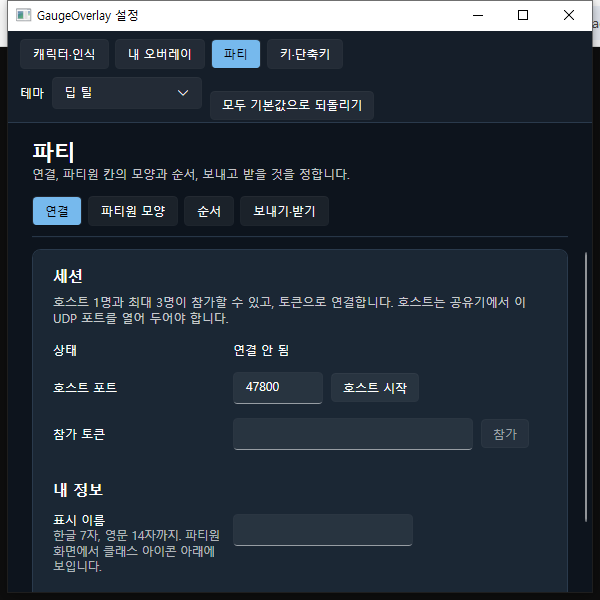

1. 호스트가 **호스트 시작**을 누르고 **토큰 복사**로 토큰을 파티 채팅 등에 붙여 넣습니다.
2. 참가자는 토큰을 **참가 토큰** 칸에 붙여 넣고 **참가**를 누릅니다.
3. 파티원마다 번호가 붙은 창이 따로 생깁니다. 순서는 파티 → 순서에서 정합니다(서포터를 한 자리에 고정할 수 있음).

버전의 앞 두 숫자가 호스트와 같아야 참가할 수 있습니다(끝자리는 달라도 됨). 다르면 두 버전을 알려 주니, 낮은 쪽이 업데이트한 뒤 다시 참가하세요. 토큰은 한 세션에서만 쓰입니다. 호스트가 나가면 세션이 끝나고 토큰도 더 이상 쓸 수 없습니다. 보낼 그룹과 받을 것(파티원의 색, 크기, 배치)은 보내기·받기에서 고릅니다. 내 칸 모양을 바꾼 뒤 파티원에게 보내려면 **업데이트**를 누릅니다.

**참가 요청 승인** (파티 → 연결, 기본으로 켜짐): 호스트일 때 처음 보는 기기가 참가하려 하면 화면 오른쪽 아래에 **허용 / 거절** 창이 뜹니다. 게임 입력은 빼앗지 않습니다. 30초 안에 답하지 않으면 참가자에게 "호스트가 응답하지 않았습니다"가 뜹니다. 허용한 기기는 **신뢰한 기기**에 남아 다음부터는 묻지 않고, 목록에서 지울 수 있습니다. **내보내기**한 기기는 그 세션에 같은 토큰으로 다시 들어올 수 없고 신뢰한 기기에서도 빠집니다(파티 → 연결의 **다시 허용**으로 풀 수 있음). 참가자는 호스트와의 연결이 잠깐 끊기면 60초 동안 저절로 다시 연결합니다("다시 연결 중…").

## 어떻게 동작하나요

- 화면 읽기는 **Vortice**(C#에서 DirectX를 쓰는 라이브러리)로 합니다. 윈도우가 모니터에 보내는 화면을 그래픽카드에서 그대로 받아옵니다(DXGI 데스크톱 복제, 또는 Windows Graphics Capture). OBS가 화면을 녹화할 때 쓰는 것과 같은 방식입니다.
- 받은 화면에서 스킬창, 버프 줄, 디버프 줄, 아덴 게이지, 캐릭터 주변(단심 글자)만 잘라 색과 숫자 모양을 비교해 쿨과 남은 시간을 알아냅니다.
- 게임 프로세스에는 손대지 않습니다. 게임 파일, 메모리, 패킷을 읽거나 바꾸지 않고, 게임에 키 입력을 보내지도 않습니다. 키보드는 앱 단축키(RegisterHotKey)에만 씁니다.
- 매 프레임 전부 읽지 않고, 숫자가 바뀔 때쯤과 스킬이 준비될 때쯤에만 자주 읽습니다. 게임이 꺼져 있으면 캡처를 멈춥니다.

### 사용량

Ryzen 5 5600X, RTX 3070, 1920×1080에서 잰 값입니다.

| 상태 | CPU | GPU | 메모리 |
|---|---|---|---|
| 게임 중 | 약 1–2% | 약 1–2% | 약 150–200MB |
| 게임이 꺼져 있을 때 (대기) | 0.1% 미만 | 0% | 약 150–200MB |

끈 기능은 화면을 읽지 않으므로 그만큼 사용량이 줄어듭니다. 예를 들어 디버프를 '없음'으로 두면 디버프 줄을, 단심을 끄면 단심을 읽지 않고, 내 오버레이에서 숨기고 파티에도 보내지 않는 스킬 칸은 읽지 않습니다.

## 알아 둘 점

- 스킬창 맞추기는 스킬을 쓸 수 있는 곳에서 모든 스킬이 준비된 상태로 해야 정확합니다.
- 게임의 버프 크기, 보스 디버프 크기, 데미지 폰트 크기는 자동으로 찾지 않습니다. 설정의 값이 게임과 다르면 버프·디버프·암수·단심 글자를 읽지 못합니다.
- 쿨타임 숫자가 잠시 읽히지 않는 동안은 추정으로 표시하며, 점선 테두리로 구분합니다. 다음에 제대로 읽히면 바로 고쳐집니다.
- 버프 크기 80–110%에서는 버프 타이머의 십의 자리를 가끔 놓칠 수 있습니다(예: 19를 9로). 앱은 카운트다운을 따라 이를 보정합니다.
- 파티 호스트가 통신사 CGNAT 뒤에 있으면 참가자가 접속할 수 없습니다. 이때는 다른 사람이 호스트를 맡아 주세요.
- 앱은 하나만 실행됩니다.
